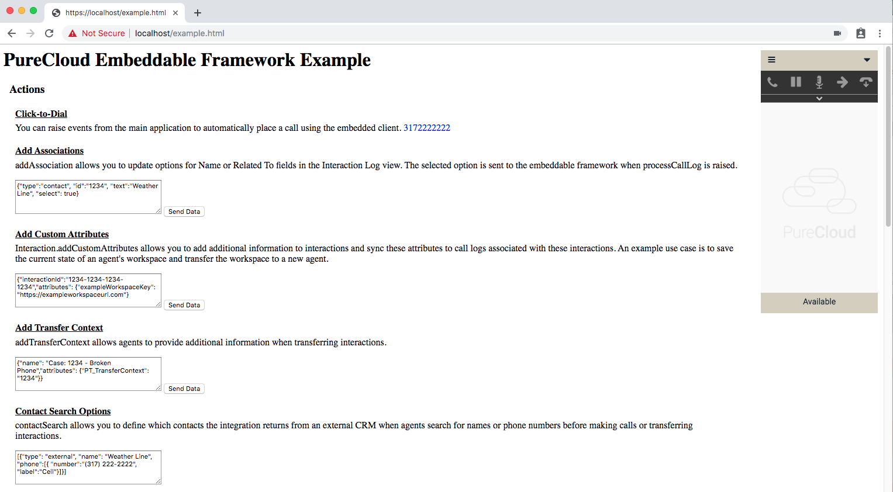

# Genesys Cloud Embedded Framework — local tooling server

This repository started as a [PureCloud Embeddable Framework](https://developer.genesys.cloud/api/embeddable-framework/) example and has grown into a **local HTTPS/HTTP dev server** for experimenting with the embedded client, `postMessage` traffic, platform notification WebSockets, and related Genesys Cloud APIs.

The server serves static pages from [`src/`](src/), hosts a local [`framework.js`](src/framework.js) for CRM integration, injects a shared site nav, and (optionally) exposes a bridge POC API.



## Table of contents

- [Quick start](#quick-start)
- [HTTPS and local framework](#https-and-local-framework)
- [Site navigation and tools](#site-navigation-and-tools)
- [Embedded Framework configuration](#embedded-framework-configuration)
- [Diagnostics auth and notifications](#diagnostics-auth-and-notifications)
- [Copy to clipboard](#copy-to-clipboard)
- [Original example page](#original-example-page)
- [Bridge POC](#bridge-poc)
- [Project layout](#project-layout)
- [License](#license)

## Quick start

**Prerequisites:** Git, Node.js (with npm), and a Genesys Cloud org. For iframe login you need an OAuth client with **Token Implicit Grant (Browser)** enabled. See [Create an OAuth client](https://help.genesys.cloud/?p=188023).

1. Clone the repository and install dependencies:

   ```bash
   npm install
   ```

2. Start the server:

   ```bash
   npm start
   ```

   Development reload for server/bridge changes:

   ```bash
   npm run dev
   ```

3. Open in a browser:

   - **HTTP:** `http://localhost:8080/` (nav and pages; clipboard may be limited on non-secure origins)
   - **HTTPS:** `https://localhost/` when certificates in [`https-requirements/`](https-requirements/) are present (recommended for EF, WebRTC, and clipboard)

   Install the CA from `https://localhost/ca.crt` (or the file served at `/ca.crt`) if the browser warns about the local certificate.

Default static entry is under `/src`; the in-app nav lists all registered tools.

## HTTPS and local framework

- TLS material lives in [`https-requirements/`](https-requirements/) (`localhost.key`, `localhost.crt`, `ca.crt`).
- The embedded CRM iframe can load **`https://localhost/framework.js`** so the parent page and framework share your local host. Permissions for camera, microphone, and local network access are set on responses from [`server.js`](server.js).
- Shared iframe defaults (region URL, `allow` attribute, mount helper) are in [`src/scripts/ef-iframe-config.js`](src/scripts/ef-iframe-config.js). Adjust `__EF_IFRAME_SRC__` for your Genesys Cloud region (`apps.{region}.pure.cloud`).

## Site navigation and tools

Navigation groups are defined in [`server.js`](server.js) (`NAV_MANIFEST`) and rendered via [`src/nav.js`](src/nav.js).

### Embedded Framework

| Page | Path | Purpose |
|------|------|---------|
| **EF Message Logger** | [`paypaltrouble.html`](src/paypaltrouble.html) | Log all `postMessage` traffic from the embedded client; optional platform WSS subscription to `v2.users.{userId}.conversations` for participant payloads; export to the parser. |
| **User Notifications** | [`user-notifications.html`](src/user-notifications.html) | Dedicated page (not part of the logger): subscribe to user-scoped notification topics for the **logged-in** EF user via diagnostics token, topic multiselect (`availabletopics`), per-topic subscribe results, WSS stream. Defaults include `persistentconnection`. |
| **EF Message Parser** | [`ef-message-parser.html`](src/ef-message-parser.html) | Review exported messages with collapsible JSON; **Copy** per card copies the full payload JSON. |
| **EF Phone Diagnostics** | [`ef-phone-diagnostics.html`](src/ef-phone-diagnostics.html) | Login, station, and WebRTC / Media Helper event inspection. |
| **EF Phone Diagnostics (Media Helper)** | [`media-helper-gate.html`](src/media-helper-gate.html) | Variant focused on Media Helper gate scenarios. |
| **Embeddable Framework Example** | [`example.html`](src/example.html) | Classic interactive API demo (`example.js`). |

### Streaming tests

| Page | Path | Purpose |
|------|------|---------|
| **Campaign Display** | [`campaign-display.html`](src/campaign-display.html) | User-topic WSS subscription with campaign call / contact-list lookup. |
| **Call Back Builder** | [`paypal-callback-builder.html`](src/paypal-callback-builder.html) | Callback URL construction helpers. |
| **Transcription Display** | [`transcription.html`](src/transcription.html) | Conversation transcription notification stream. |

### General tools

| Page | Path | Purpose |
|------|------|---------|
| **Mermaid Live Editor** | [`mermaid.html`](src/mermaid.html) | Diagram editing. |
| **Conversation Gantt** | [`conversation-gantt.html`](src/conversation-gantt.html) | Conversation timeline visualization. |

Older launchpad pages are grouped under **Out of Date** in the nav.

## Embedded Framework configuration

1. **`example.html` / iframe region** — Point the softphone iframe at your region’s apps URL. See [iframe URLs](https://developer.genesys.cloud/api/embeddable-framework/deployments/iframe-urls.html) and [region list](https://help.genesys.cloud/?p=167012). For most EF tools, prefer editing [`ef-iframe-config.js`](src/scripts/ef-iframe-config.js) instead of each HTML file.

2. **`framework.js`** — Under `clientIds`, add your OAuth **Client ID** for the region where your org lives. See [clientIds](https://developer.genesys.cloud/api/embeddable-framework/configMethods/clientIds.html).

3. **Genesys region select** — Streaming pages use [`genesys-connection-fields.js`](src/scripts/genesys-connection-fields.js) with [`src/data/genesys_regions.json`](src/data/genesys_regions.json) to resolve `https://api.{domain}`.

## Diagnostics auth and notifications

Several EF pages request an access token from the embedded client using `postMessage`:

- Parent sends `{ "type": "diagnosticsGetAuthToken" }`
- Iframe replies with `{ "type": "diagnosticsAuthToken", "data": { "token", "userId", ... } }`

Shared polling logic: [`src/scripts/ef-diagnostics-auth.js`](src/scripts/ef-diagnostics-auth.js).

**User Notifications** ([`user-notifications.js`](src/scripts/user-notifications.js)) builds on:

- [`ef-notification-topics.js`](src/scripts/ef-notification-topics.js) — user topic filtering and defaults (includes `v2.users.{id}.persistentconnection`)
- [`ef-notification-client.js`](src/scripts/ef-notification-client.js) — notification channel, per-topic subscribe with succeeded/denied results, WebSocket manager
- [`ef-topic-multiselect.js`](src/scripts/ef-topic-multiselect.js) — topic picker UI

**Message Logger → Parser workflow**

1. Open **EF Message Logger**, log in to the iframe, collect messages.
2. Click **Open in Parser** (stores `sessionStorage` key `ef_message_log_export`).
3. Or from **User Notifications**, use **Open in Parser** after WSS messages arrive (same storage format, `source: "User Notifications"`).

## Copy to clipboard

[`src/scripts/ef-clipboard.js`](src/scripts/ef-clipboard.js) provides **Copy all** on readonly outputs:

| Page | Outputs |
|------|---------|
| EF Message Logger | Messages log, Participant data log |
| User Notifications | WSS stream |
| Campaign Display | WSS stream, Contact list lookup |

On **EF Message Parser**, each message card has **Copy** (full `message.data` JSON). Nested JSON tree nodes do not have copy buttons.

Styles: [`src/css/ef-copy-buttons.css`](src/css/ef-copy-buttons.css).

## Original example page

1. Run the server (see [Quick start](#quick-start)).
2. Open `https://localhost/example.html` (or HTTP on port 8080).
3. Log in to the client and use the action panels (click-to-dial, attributes, notifications, and so on) via [`example.js`](src/scripts/example.js).

## Bridge POC

Bridge harness UI: [`/bridge-poc`](src/bridge-poc.html) (evaluate conference bridge state via server API).

### Environment variables

Set these before starting the server (e.g. in `.env`):

- `GENESYS_BASE_URL`
- `GENESYS_OAUTH_BASE_URL` (optional; defaults to `GENESYS_BASE_URL`)
- `GENESYS_CLIENT_ID`
- `GENESYS_CLIENT_SECRET`
- `GENESYS_DATA_TABLE_ID` (optional for local evaluation; required to write updates)
- `GENESYS_CONVERSATION_PATH_TEMPLATE` (optional)
- `GENESYS_DATA_TABLE_GET_PATH_TEMPLATE` (optional)
- `GENESYS_DATA_TABLE_UPDATE_PATH_TEMPLATE` (optional)
- `GENESYS_DATA_TABLE_KEY_FIELD` (optional; defaults to `dnis`)
- `GENESYS_DATA_TABLE_ANCHOR_FIELD` (optional; defaults to `conferenceConversationId`)
- `GENESYS_MERGE_ACTION_PATH_TEMPLATE` (optional)
- `GENESYS_DISCONNECT_ACTION_PATH_TEMPLATE` (optional)

### Bridge endpoint

`POST /api/bridge-poc/evaluate`

Example payload:

```json
{
  "conferenceConversationId": "stored-anchor-id",
  "currentConversationId": "current-call-id",
  "dnis": "15555551212"
}
```

The response returns `ACTIVE` when the stored conference is still active, or `NEW` when a new bridge anchor should be written back to the data table.

## Project layout

```
server.js                 Express app, nav manifest, HTTPS, bridge routes
src/                      Static HTML, CSS, scripts, framework.js
src/bridge/               Bridge POC service
src/scripts/              Page logic and shared EF modules
https-requirements/       Local TLS certificates
```

## License

This content is [licensed](LICENSE) under the MIT license.

**Genesys documentation**

- [Embeddable Framework overview](https://developer.genesys.cloud/api/embeddable-framework/)
- [About Embeddable Framework](https://help.genesys.cloud/?p=196909)
